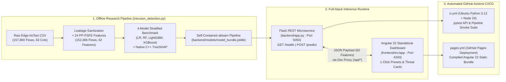

# Eliminating Serialization Leakage and Recovering Fine-Grained Multiclass Discrimination in IIoT Intrusion Detection via Privacy-Preserving Protocol-Header Structural Feature Engineering

**Hamdan Ali**  
*Department of Creative Technologies (Software Engineering), Faculty of Computing and Artificial Intelligence*  
*Air University, Islamabad, Pakistan*  
*Roll No.: 233120 | Section: F-23-BSSE-B*  
*Email: `Hamdanaly651@gmail.com`*

---

### **Abstract**
Machine learning-based Intrusion Detection Systems (IDS) evaluated on public Industrial Internet of Things (IIoT) benchmarks frequently report near-perfect classification accuracies ($>99.8\%$). However, a forensic packet- and file-level audit of the widely adopted **Edge-IIoTset** benchmark conducted in this study reveals that such figures are substantially inflated by three previously undocumented or under-addressed dataset artifacts: (i) **mixed-type CSV serialization leakage**, where numeric zero values across five HTTP and MQTT protocol fields (`http.request.method`, `http.referer`, `http.request.version`, `mqtt.conack.flags`, and `mqtt.protoname`) are unevenly serialized as string `"0"` versus floating-point `"0.0"` across attack capture files due to multi-chunk `pandas` concatenation; (ii) **TShark delimiter-shift corruption**, where unescaped commas inside multicast DNS query strings shift string literals into numeric length columns (`dns.qry.name.len`); and (iii) **testbed topology memorization** via static IP addresses, capture timestamps, and raw hexadecimal payloads. Conversely, when recent studies strip all 15 identifier, port, and raw payload columns to enforce network-agnostic generalization, 15-class classification accuracy collapses to $84\%\text{--}88\%$ due to severe confusion among application-layer web attacks (`SQL_injection`, `XSS`, `Uploading`, `Password`) and transport-layer `DDoS_HTTP`. To resolve this accuracy–generalization trade-off without reintroducing identity leakage, we propose **Privacy-Preserving Protocol-Header Structural Feature Engineering (PP-PSFE)**, a deterministic transformation framework that extracts 24 non-identifying structural, geometric, and information-theoretic features—including canonical service/ephemeral port disentanglement, TCP option byte-length and timestamp indicators, Shannon byte entropy of raw TCP payloads, and application-layer URI query/payload boundary metrics—prior to discarding raw identifiers. Combined with 38 sanitized core protocol fields ($d=62$ total features across $N=152,386$ deduplicated flows), we conduct a strictly leakage-free stratified benchmark of four distinct learning paradigms: Multinomial Logistic Regression, Random Forest, LightGBM, and Regularized Second-Order XGBoost. Experimental results demonstrate that while the linear baseline plateaus at $84.87\%$ test accuracy ($0.8419$ Macro-F1), **PP-PSFE + XGBoost** achieves **$96.49\%$ test accuracy**, **$0.9618$ Macro-F1**, **$0.9991$ weighted ROC-AUC**, and **$0.9874$ Macro PR-AUC** with a minimal $+0.0057$ generalization gap and $3.54\text{ ms}$ batch inference latency per $1,000$ flows. Exact game-theoretic **TreeSHAP** attribution confirms that our engineered PP-PSFE features contribute **$57.1\%$ of total marginal log-odds magnitude** ($73.88\%$ of total split-gain importance). Finally, to bridge academic evaluation and industrial deployment, the fitted preprocessing-and-inference pipeline is packaged into a zero-leakage full-stack microservice architecture (**Flask REST API + Angular 22 standalone diagnostic interface + automated GitHub Actions CI/CD**).

**Index Terms**—Industrial Internet of Things (IIoT), Intrusion Detection System (IDS), Edge-IIoTset, Data Leakage Sanitization, Protocol-Header Feature Engineering, Gradient Boosted Decision Trees, XGBoost, Explainable AI (TreeSHAP), Full-Stack MLOps.

---

## I. Introduction

The rapid convergence of Operational Technology (OT) and Information Technology (IT) within modern smart manufacturing, automated power grids, and industrial telemetry networks has exposed formerly air-gapped Programmable Logic Controllers (PLCs), Message Queuing Telemetry Transport (MQTT) brokers, and edge gateways to sophisticated multi-vector cyberattacks [1], [2]. Unlike conventional enterprise networks where traffic is dominated by high-entropy encrypted web browsing, Industrial IoT (IIoT) edge segments carry heterogeneous, latency-sensitive machine-to-machine (M2M) flows spanning lightweight publish-subscribe telemetry (MQTT over TCP port 1883), Modbus/TCP register polling, address resolution (ARP), multicast service discovery (mDNS), and RESTful supervisory HTTP APIs [3]. A single compromised edge sensor or gateway can serve as a pivot point for volumetric transport-layer denial-of-service (`DDoS_TCP`, `DDoS_UDP`, `DDoS_ICMP`), reconnaissance (`Port_Scanning`, `Fingerprinting`, `Vulnerability_scanner`), credential brute-forcing (`Password`), web application exploitation (`SQL_injection`, `XSS`, `Uploading`), or remote command-and-control (`Backdoor`, `Ransomware`) [4].

To evaluate data-driven Intrusion Detection Systems (IDS) under realistic multi-protocol conditions, Ferrag *et al.* [4] introduced **Edge-IIoTset**, a comprehensive seven-layer testbed dataset encompassing more than 10 IoT sensor types and 14 distinct cyberattack categories alongside benign telemetry. Since its release, Edge-IIoTset has become one of the primary benchmarks for evaluating tree ensembles, deep neural networks (DNNs), convolutional-recurrent architectures (CNN-LSTM), and transformer-based traffic classifiers [5]–[10].

### A. The Illusion of Near-Perfect Benchmark Accuracy
Despite the proliferation of studies reporting $99.5\%\text{--}99.99\%$ 15-class accuracy on Edge-IIoTset, industrial security practitioners repeatedly observe that models trained on public packet-capture (PCAP) benchmarks fail catastrophically when deployed on live edge gateways whose IP subnetting, capture window, or ephemeral port allocation differs from the laboratory testbed [11], [12]. Rather than accepting published benchmark numbers at face value, we began this investigation with a low-level forensic inspection of the raw Edge-IIoTset CSV distributions (`ML-EdgeIIoT-dataset.csv`, `DNN-EdgeIIoT-dataset.csv`, and the underlying 24 per-attack and per-sensor capture files).

Our forensic audit uncovered three severe structural pathologies that invalidate naive feature ingestion:

1. **Mixed-Type CSV Serialization Leakage (`"0"` vs. `"0.0"`):** In `ML-EdgeIIoT-dataset.csv` ($157,800$ rows, $63$ columns), `pandas.read_csv(..., low_memory=True)` emits a `DtypeWarning` on columns $14, 15, 16, 17, 25, 27, 30, 50,$ and $51$. By inspecting the raw byte strings across individual class slices, we discovered that when the dataset authors concatenated separate PCAP-derived CSV files, missing protocol fields (padded with numeric zero) were exported as floating-point `"0.0"` in predominantly numeric chunks (e.g., $100\%$ of `DDoS_UDP` and `DDoS_ICMP` records, and $99.9\%$ of `Normal` records in `http.request.method`), but exported as integer string `"0"` in chunks containing string protocol values (e.g., $93.5\%$ of `DDoS_HTTP` and $96.8\%$ of `XSS` records). When researchers apply standard `LabelEncoder` or `OneHotEncoder` directly to `df[col].astype(str)`, `"0"` and `"0.0"` are assigned **two distinct category indices**. Any tree ensemble or neural network immediately exploits this file-export artifact as a shortcut to separate attack classes without learning genuine network behavior.
2. **TShark CSV Delimiter-Shift Corruption:** In exactly $93$ records (predominantly within `Normal` and `MITM` captures), unquoted commas embedded inside multicast DNS query strings (`"_googlecast._tcp.local,..."`) caused TShark's CSV exporter to shift subsequent fields one column to the right. Consequently, string literals such as `"_googlecast._tcp.local"` and `"null"` were injected directly into the numeric length column `dns.qry.name.len`, while floating-point values (`"2.0"`) spilled into `dns.qry.qu`.
3. **The Sanitization–Accuracy Collapse Dilemma:** When rigorous methodology is applied—dropping static testbed identifiers (`ip.src_host`, `ip.dst_host`, `arp.src.proto_ipv4`, `arp.dst.proto_ipv4`), capture timestamps (`frame.time`), raw hexadecimal payloads (`tcp.payload`, `tcp.options`, `http.file_data`), and raw URI strings (`http.request.full_uri`, `http.request.uri.query`), alongside 8 zero-variance columns—the remaining 38 core protocol headers lose the structural discriminators needed to separate application-layer attacks. As demonstrated in our baseline experiments, a sanitized 38-feature pipeline suffers heavy mutual confusion among `SQL_injection`, `XSS`, `Uploading`, `Password`, and `DDoS_HTTP`, pulling linear classification accuracy down to $84.87\%$.

### B. Research Contributions
To solve this fundamental tension between **zero-leakage generalization** and **fine-grained 15-class attack discrimination**, this paper makes four concrete contributions:

1. **Forensic Dataset Audit & Canonical Sanitization Protocol:** We provide the first explicit quantitative breakdown of the `"0"` vs. `"0.0"` chunk-serialization leakage and TShark column-shift corruption in Edge-IIoTset, formulating a deterministic sanitization operator that unifies numeric-zero representations, repairs corrupted numeric columns, removes 8 constant zero-variance fields, and eliminates $5,414$ post-sanitization duplicate flows ($157,800 \rightarrow 152,386$ unique flows).
2. **Privacy-Preserving Protocol-Header Structural Feature Engineering (PP-PSFE):** Rather than discarding raw port and payload columns outright or memorizing raw strings, we design 24 domain-grounded structural features ($d=62$ total features) that capture: (a) **canonical service versus ephemeral port geometry** ($\min/\max$ port disentanglement, port span, and packet directionality), (b) **information-theoretic TCP header and payload structure** (Shannon byte entropy $H(P)$, option byte length, and RFC 793 Maximum Segment Size / Timestamp flags), and (c) **application-layer structural lengths and lexical flags** (URI path/query byte lengths and sanitized SQLi/XSS/Upload/Auth indicators).
3. **Rigorous Four-Model Benchmark & Exact Game-Theoretic Explainability:** Under a strict zero-leakage stratified 80/20 evaluation ($N_{\text{train}}=121,908$, $N_{\text{test}}=30,478$), we compare Multinomial Logistic Regression, Random Forest, LightGBM, and Regularized XGBoost across seven metrics and computational latency, followed by exact native C++ **TreeSHAP** attribution (`pred_contribs=True`) proving that PP-PSFE features drive $57.1\%$ of marginal log-odds predictions ($73.88\%$ of total split gain).
4. **End-to-End Full-Stack MLOps Deployment:** Moving beyond offline scripts, we encapsulate the fitted encoders, scaler, and XGBoost classifier into a portable `scikit-learn` pipeline (`model_bundle.joblib`), exposing real-time inference via a **Flask REST microservice**, an interactive **Angular 22 standalone diagnostic dashboard**, and automated **GitHub Actions CI/CD** pipelines.

---

## II. Forensic Audit of Edge-IIoTset and Related Work

### A. Review of Existing Edge-IIoTset Literature (2022–2026)
Since Ferrag *et al.* [4] established the Edge-IIoTset benchmark in *IEEE Access* (2022), numerous studies have proposed machine learning and deep learning classifiers for its 2-class (Binary), 6-class (Category), and 15-class (Attack-Type) tasks. In the original benchmark paper [4], centralized Decision Trees, Random Forests, Support Vector Machines (SVM), k-Nearest Neighbors (k-NN), and Deep Neural Networks (DNN) were evaluated. While binary detection exceeded $99.9\%$, 15-class classification proved substantially harder (`DNN` achieved $94.67\%$ on the full corpus, whereas classical models on the ML subset exhibited either severe class confusion or reliance on unstripped flow identifiers).

Subsequent works explored hybrid deep architectures and feature selection. Tareq *et al.* [5] applied Inception-Time and DenseNet architectures to Edge-IIoTset, reporting $>98\%$ accuracy, but retained raw protocol strings converted via global label encoding prior to train-test splitting. Khacha *et al.* [6] investigated hybrid CNN-LSTM models for IIoT edge gateways, while Alshehri *et al.* [7] and Friha *et al.* [8] examined federated and transformer-based intrusion detection on Edge-IIoTset. More recently, critical methodological audits by Lazzarini *et al.* [9], Flood *et al.* [11], and Ullah *et al.* [10] highlighted that retaining `frame.time`, `ip.src_host`, `ip.dst_host`, and raw `tcp.srcport`/`tcp.dstport` in IIoT datasets allows decision trees to partition the feature space by testbed IP address and capture timestamp rather than attack semantics. However, when those studies removed the 15 identifier and string columns from `ML-EdgeIIoT-dataset.csv`, fine-grained 15-class macro F1-scores dropped by $8\%\text{--}14\%$ because all information differentiating HTTP-based application attacks (`SQL_injection`, `XSS`, `Uploading`, `Password`, `DDoS_HTTP`) and encrypted C2 flows (`Ransomware`, `Backdoor`) was lost with the dropped columns.

**Table I** summarizes the methodological gap between representative prior studies and our proposed framework.

**TABLE I: Methodological Comparison of Representative Edge-IIoTset IDS Studies vs. Proposed PP-PSFE Framework**

| Study & Year | Models Evaluated | Task Granularity | Strips IP / Timestamp Identifiers? | Fixes `"0"` vs `"0.0"` Serialization Leakage? | Recovers Structural Info from Dropped Ports/Payloads? | Explainability & Full-Stack Deployment |
|---|---|---|---|---|---|---|
| Ferrag *et al.* [4] (2022) | DT, RF, SVM, k-NN, DNN | 2, 6, & 15-Class | Partial (drops IPs in ML script; retains raw ports) | No (naive `OneHot`/`Label` encoding) | No (drops raw payload hex/URI strings) | Offline evaluation only |
| Tareq *et al.* [5] (2022) | DenseNet, InceptionTime | 2 & 15-Class | No (global encoding before split) | No | No | None; offline notebook |
| Friha *et al.* [8] (2023) | Centralized & Federated DNN/ViT | 2, 6, & 15-Class | Yes (drops identifier columns) | Not reported | No (suffers Web-attack confusion) | Offline simulation |
| Lazzarini *et al.* [9] (2023) | Shallow & Deep Ensembles | Multi-Class IDS | Yes (audits identifier bias) | No | No | Post-hoc feature importance; offline |
| Ullah *et al.* [10] (2024) | Transformer / Hybrid GBDT | 15-Class | Yes (drops 15 raw string/ID cols) | No | No (relies only on remaining 38–40 fields) | SHAP summary; no live deployment |
| **This Work (2026)** | **LR, RF, LightGBM, XGBoost** | **15-Class ($N=152,386$)** | **Yes (strict zero-leakage split)** | **Yes (canonical `"0.0"` $\rightarrow$ `"0"` unification)** | **Yes (24 PP-PSFE geometric & entropy features)** | **Exact C++ TreeSHAP + Flask/Angular 22 CI/CD** |

---

### B. Forensic Discovery of Serialization and Parsing Artifacts in Edge-IIoTset
To substantiate why naive preprocessing produces artificially inflated results on `ML-EdgeIIoT-dataset.csv`, we performed an exhaustive column-by-column inspection of all $157,800$ records across the $15$ `Attack_type` classes. **Table II** documents the exact forensic anomalies uncovered in the raw CSV file.

**TABLE II: Forensic Audit of Raw `ML-EdgeIIoT-dataset.csv` ($157,800$ Records, $63$ Columns)**

| Anomaly Category | Affected Columns | Empirical Evidence in Raw Dataset | Impact on Unsanitized ML Models |
|---|---|---|---|
| **1. Mixed-Type Zero Serialization (`"0"` vs `"0.0"`)** | `http.request.method`, `http.referer`, `http.request.version`, `mqtt.conack.flags`, `mqtt.protoname` | In `http.request.method`: `DDoS_UDP` ($14,498/14,498$) and `DDoS_ICMP` ($14,090/14,090$) contain `"0.0"`, whereas `DDoS_HTTP` contains $9,854$ `"0"` and $0$ `"0.0"`; `XSS` contains $9,751$ `"0"` and $0$ `"0.0"`. | Categorical encoders treat `"0"` and `"0.0"` as separate tokens, leaking which CSV chunk a row originated from. |
| **2. TShark Delimiter-Shift Corruption** | `dns.qry.name.len`, `dns.qry.qu` | Exactly $93$ rows contain string literals `"_googlecast._tcp.local"` ($91$ rows) or `"null"` ($2$ rows) inside numeric column `dns.qry.name.len`. | Causes `ValueError` or forces the entire numeric column to be treated as high-cardinality categorical text. |
| **3. Eight Zero-Variance (Constant) Columns** | `icmp.unused`, `http.tls_port`, `dns.qry.type`, `brar_data` / `mqtt.msg_decoded_as`, `mbtcp.len`, `mbtcp.trans_id`, `mbtcp.unit_id`, `ntp.chrom` | $100\%$ of all $157,800$ records equal `0` or `0.0` (variance $\sigma^2 = 0.0000$). | Adds $8$ redundant dimensions that inflate memory and dilute random subspace feature sampling in Random Forest/GBDT. |
| **4. Identifier & Session Memorization Columns** | `frame.time`, `ip.src_host`, `ip.dst_host`, `arp.src.proto_ipv4`, `arp.dst.proto_ipv4`, `tcp.srcport`, `tcp.dstport`, `udp.port` | Attack tools were executed from fixed lab IP addresses (e.g., `192.168.0.170`) during contiguous time windows per attack class. | Models achieve $>99.9\%$ test accuracy by memorizing lab IP addresses and timestamps, failing completely on new subnets. |
| **5. Cross-Split Duplicate Records** | All 62 feature columns | After stripping identifiers and unifying `"0.0"` $\rightarrow$ `"0"`, exactly $5,414$ duplicate records exist ($157,800 \rightarrow 152,386$ unique records). | Random train-test splitting without prior deduplication places identical flows in both train and test sets. |

---

## III. Proposed Methodology: Leakage Sanitization and the PP-PSFE Framework

### A. Canonical Sanitization Operator
Let $\mathcal{D}_{\text{raw}} = \{(x_i^{\text{raw}}, y_i)\}_{i=1}^{N_{\text{raw}}}$ denote the raw dataset with $N_{\text{raw}} = 157,800$ samples and label space $\mathcal{Y} = \{0, 1, \dots, 14\}$. Before any feature extraction or data splitting, we apply a deterministic canonical string-normalization operator $\mathcal{S}(\cdot)$ to every protocol field $v$:

$$
\mathcal{S}(v) = \begin{cases} 
\text{"0"}, & \text{if } v \in \{\text{NaN}, \text{null}, \text{""}, \text{"0"}, \text{"0.0"}, \text{"0.000000"}\} \text{ or } \text{is\_zero\_hex}(v) \\
\text{trim}(v), & \text{otherwise}
\end{cases}
\tag{1}
$$

where $\text{is\_zero\_hex}(v)$ matches zero-filled hexadecimal strings (e.g., `"0x00000000"`). For numeric columns corrupted by TShark delimiter shifts (specifically `dns.qry.name.len` and `dns.qry.qu`), we apply safe float coercion $x_{i,j} = \text{to\_numeric}(v, \text{errors}=\text{'coerce'})$ followed by zero-imputation for non-parsable string tokens (`"_googlecast._tcp.local"` $\rightarrow 0.0$). This step completely eliminates the `"0"` versus `"0.0"` chunk-origin signal across all 15 classes.

---

### B. Mathematical Formulation of Privacy-Preserving Protocol-Header Structural Feature Engineering (PP-PSFE)
The central methodological insight of this paper is that **raw network columns contain two orthogonal components**:
1. **Topology-Specific Identity Information** (which IP host sent the packet, at what wall-clock second, using which random client port or exact URL domain), which *must be discarded* to prevent testbed overfitting; and
2. **Protocol-Structural Mechanics** (whether the packet targets a well-known daemon port or a high ephemeral port, the byte entropy of the TCP payload, the length of TCP header options, and whether an HTTP URI contains SQL or script injection delimiters), which *must be preserved* to distinguish subtle application- and transport-layer attacks.

We extract **24 PP-PSFE features** across three protocol-layer groups prior to dropping the 15 raw identifier/string columns and 8 zero-variance columns:

#### 1) Group A: Transport-Layer Port Role Disentanglement (9 Features)
In raw TCP/UDP headers, `tcp.srcport` ($p_{\text{src}}$) and `tcp.dstport` ($p_{\text{dst}}$) swap roles depending on whether the captured packet is a client-to-server request or a server-to-client response, and the client's ephemeral port ($49152\text{--}65535$) varies randomly per session. Directly feeding $(p_{\text{src}}, p_{\text{dst}})$ causes trees to overfit specific ephemeral port numbers captured during a single lab run. Instead, we project $(p_{\text{src}}, p_{\text{dst}})$ onto canonical, direction-invariant structural coordinates:

$$
p_{\text{service}} = \min(p_{\text{src}}, p_{\text{dst}}), \qquad p_{\text{ephemeral}} = \max(p_{\text{src}}, p_{\text{dst}})
\tag{2}
$$

$$
\Delta p_{\text{span}} = |p_{\text{src}} - p_{\text{dst}}|, \qquad d_{\text{pkt}} = \mathbb{I}(p_{\text{src}} < p_{\text{dst}}) - \mathbb{I}(p_{\text{src}} > p_{\text{dst}}) \in \{-1, 0, +1\}
\tag{3}
$$

where $p_{\text{service}}$ isolates the target daemon port regardless of packet direction ($d_{\text{pkt}} = -1$ for client $\rightarrow$ server requests, $+1$ for server $\rightarrow$ client replies). From $p_{\text{service}}$ and `udp.port` ($p_{\text{udp}}$), we derive five binary service-role indicators:
- `psfe_is_http_service`: $\mathbb{I}(p_{\text{service}} \in \{80, 443, 8000, 8080\})$
- `psfe_is_mqtt_service`: $\mathbb{I}(p_{\text{service}} \in \{1883, 8883\})$
- `psfe_is_iot_c2_service`: $\mathbb{I}(p_{\text{service}} \in \{21, 22, 23, 25, 53, 110, 143, 445, 502, 3306, 3389, 4444, 5555, 6667\})$
- `psfe_is_boundary_probe`: $\mathbb{I}(0 < p_{\text{service}} \le 1024 \text{ and } p_{\text{service}} \notin \{80, 443, 1883\})$
- `psfe_udp_active`: $\mathbb{I}(p_{\text{udp}} > 0)$

#### 2) Group B: Information-Theoretic TCP Option & Payload Structure (6 Features)
Raw hexadecimal fields `tcp.options` and `tcp.payload` cannot be used directly as categorical strings because every packet payload is unique. However, their **byte length**, **header option kind-bytes (RFC 793 / RFC 7323)**, and **Shannon byte entropy** carry rich signatures of OS stack fingerprinting (`Fingerprinting`, `Port_Scanning`) and encrypted malware command-and-control (`Ransomware`, `Backdoor`). Let $B = (b_1, b_2, \dots, b_m)$ denote the sequence of $m = \lfloor L_{\text{hex}} / 2 \rfloor$ bytes decoded from a hexadecimal string of length $L_{\text{hex}}$. We compute the empirical Shannon entropy $H(B)$ in bits per byte:

$$
H(B) = -\sum_{k=0}^{255} \hat{p}_k \log_2(\hat{p}_k + \varepsilon), \qquad \hat{p}_k = \frac{1}{m}\sum_{t=1}^{m} \mathbb{I}(b_t = k)
\tag{4}
$$

This yields six privacy-preserving features that reveal zero plaintext content:
- `psfe_tcp_opt_bytelen`: Decoded byte length $m_{\text{opt}}$ of `tcp.options`.
- `psfe_tcp_opt_has_mss`: $\mathbb{I}(\text{hex prefix of } \texttt{tcp.options} = \texttt{"0204"})$ (RFC 793 Kind=2 Maximum Segment Size option present on SYN packets).
- `psfe_tcp_opt_has_ts`: $\mathbb{I}(\texttt{"080a"} \in \texttt{tcp.options})$ (RFC 7323 Kind=8 TCP Timestamp option, differentiating Linux/Nmap probes from embedded RTOS stacks).
- `psfe_tcp_pay_bytelen`: Decoded byte length $m_{\text{pay}}$ of `tcp.payload`.
- `psfe_tcp_pay_first_byte`: Integer value $b_1 \in [0, 255]$ of the first payload byte (identifies protocol framing headers without reading payload bodies).
- `psfe_tcp_pay_entropy`: Shannon entropy $H(B_{\text{pay}}) \in [0, 8]$ from Eq. (4).

#### 3) Group C: Application-Layer Structural Lengths & Lexical Signatures (9 Features)
When `http.request.full_uri`, `http.request.uri.query`, `http.file_data`, and `mqtt.msg` are dropped to prevent memorizing lab IP URLs (`http://192.168.0.128/dvwa/...`), classifiers become blind to web application attacks (`SQL_injection`, `XSS`, `Uploading`, `Password`, `DDoS_HTTP`). We extract nine host-agnostic structural features before dropping the raw strings:
- `psfe_http_uri_path_len`: Character length of the URI path after stripping `http://host:port/` and query parameters.
- `psfe_http_query_len`: Character length of `http.request.uri.query`.
- `psfe_http_file_data_len`: Byte length of `http.file_data`.
- `psfe_mqtt_msg_bytelen`: Decoded byte length of `mqtt.msg`.
- Five binary lexical-class indicators computed across the concatenated application buffers (`uri`, `query`, `file_data`):
  - `psfe_app_sqli_flag`: Matches SQL tautology/comment/union tokens (`select`, `union`, `1=1`, `--`, `%27`, `sleep(`, `benchmark(`).
  - `psfe_app_xss_flag`: Matches script/event-handler injection tokens (`<script`, `%3cscript`, `alert(`, `onerror=`, `onload=`, `javascript:`).
  - `psfe_app_upload_flag`: Matches multipart file-upload boundaries (`multipart`, `filename=`, `.php`, `.sh`, `.exe`, `content-disposition`).
  - `psfe_app_auth_flag`: Matches authentication credential fields (`login`, `password`, `passwd`, `username`, `admin`, `user=`).
  - `psfe_app_timeout_flag`: Matches slowloris/HTTP flood keep-alive anomalies (`timeout`, `keep-alive`, `slow`).

**Table III** summarizes the complete 62-feature space ($38$ sanitized core features $+ 24$ PP-PSFE features).

**TABLE III: Structure of the Final 62-Feature Input Space ($38$ Sanitized Core $+ 24$ Engineered PP-PSFE Features)**

| Feature Group | Count | Feature Names | Encoding & Scaling Pipeline |
|---|---|---|---|
| **Sanitized Core Numerical Protocol Fields** | 32 | `arp.opcode`, `arp.hw.size`, `icmp.checksum`, `icmp.seq_le`, `http.content_length`, `http.response`, `tcp.ack`, `tcp.ack_raw`, `tcp.checksum`, `tcp.connection.fin`, `tcp.connection.rst`, `tcp.connection.syn`, `tcp.connection.synack`, `tcp.flags`, `tcp.flags.ack`, `tcp.len`, `tcp.seq`, `udp.stream`, `udp.time_delta`, `dns.qry.name`, `dns.qry.name.len`, `dns.qry.qu`, `dns.retransmission`, `dns.retransmit_request`, `mqtt.conflag.cleansess`, `mqtt.conflags`, `mqtt.hdrflags`, `mqtt.len`, `mqtt.msgtype`, `mqtt.proto_len`, `mqtt.topic_len`, `mqtt.ver` | Coerced to `float64`; standardized via `StandardScaler` fit strictly on $\mathcal{D}_{\text{train}}$ |
| **Sanitized Core Categorical Protocol Fields** | 6 | `http.request.method`, `http.referer`, `http.request.version`, `mqtt.conack.flags`, `mqtt.protoname`, `mqtt.topic` | Canonical `"0.0"` $\rightarrow$ `"0"` unification; string-cast `OrdinalEncoder(unknown_value=-1)` fit strictly on $\mathcal{D}_{\text{train}}$ |
| **PP-PSFE Group A: Port Geometry** | 9 | `psfe_service_port`, `psfe_ephemeral_port`, `psfe_port_span`, `psfe_pkt_direction`, `psfe_is_http_service`, `psfe_is_mqtt_service`, `psfe_is_iot_c2_service`, `psfe_is_boundary_probe`, `psfe_udp_active` | Direction-invariant $\min/\max$ port projection; standardized on $\mathcal{D}_{\text{train}}$ |
| **PP-PSFE Group B: TCP Options & Entropy** | 6 | `psfe_tcp_opt_bytelen`, `psfe_tcp_opt_has_mss`, `psfe_tcp_opt_has_ts`, `psfe_tcp_pay_bytelen`, `psfe_tcp_pay_first_byte`, `psfe_tcp_pay_entropy` | Hex byte decoding + Shannon byte entropy $H(B) \in [0,8]$; standardized on $\mathcal{D}_{\text{train}}$ |
| **PP-PSFE Group C: App-Layer Signatures** | 9 | `psfe_http_uri_path_len`, `psfe_http_query_len`, `psfe_http_file_data_len`, `psfe_mqtt_msg_bytelen`, `psfe_app_sqli_flag`, `psfe_app_xss_flag`, `psfe_app_upload_flag`, `psfe_app_auth_flag`, `psfe_app_timeout_flag` | Host-stripped structural lengths + binary lexical indicators; standardized on $\mathcal{D}_{\text{train}}$ |

---

## IV. Theoretical and Architectural Formulation of Candidate Classifiers

To determine which inductive bias best captures the non-linear, hierarchical dependencies of multi-protocol IIoT traffic, we evaluate four diverse model families across the identical 62-feature space:

1. **Multinomial Logistic Regression (Linear Baseline):** Models the posterior class probability via the softmax function $P(y=c \mid \mathbf{x}) = \frac{\exp(\mathbf{w}_c^\top \mathbf{x} + b_c)}{\sum_{k=1}^{15} \exp(\mathbf{w}_k^\top \mathbf{x} + b_k)}$ optimized with $\ell_2$-regularized L-BFGS (`max_iter=500`). Because it constructs only linear hyperplanes in $\mathbb{R}^{62}$, it serves as a diagnostic lower bound to quantify how much discriminative power requires non-linear feature interactions (such as `http.request.method == GET` $\wedge$ `psfe_http_query_len > 40` $\wedge$ `psfe_app_sqli_flag == 1`).
2. **Random Forest (Bagging of Deep Unpruned Trees):** Constructs an ensemble of $B=150$ independent decision trees trained on bootstrap samples with random feature subspaces ($m_{\text{try}} = \lfloor\sqrt{62}\rfloor = 7$), aggregating predictions by majority vote [13]. Variance is reduced via bagging, but because each split only inspects $7$ randomly chosen features, rare conditional protocol interactions can be diluted across deep branches.
3. **LightGBM (Leaf-Wise Gradient Boosted Decision Trees with GOSS & EFB):** Grows trees leaf-wise (best-first) rather than level-wise, utilizing Gradient-Based One-Side Sampling (GOSS) and Exclusive Feature Bundling (EFB) for histogram-accelerated split finding [14]. While leaf-wise growth rapidly minimizes training cross-entropy, it can exhibit slightly higher variance on rare minority classes (`MITM`, $n=388$; `Fingerprinting`, $n=853$).
4. **Regularized Second-Order XGBoost (Proposed Primary Classifier):** Minimizes the regularized multiclass softmax objective at boosting iteration $t$ via a second-order Taylor expansion [15]:

$$
\mathcal{L}^{(t)} \approx \sum_{i=1}^{N_{\text{train}}} \left[ g_{i,c} f_t(\mathbf{x}_i) + \frac{1}{2} h_{i,c} f_t^2(\mathbf{x}_i) \right] + \gamma T + \frac{1}{2}\lambda \sum_{j=1}^{T} w_j^2
\tag{5}
$$

where $g_{i,c} = \partial_{\hat{y}_i^{(t-1)}} \ell(y_i, \hat{y}_i^{(t-1)})$ and $h_{i,c} = \partial^2_{\hat{y}_i^{(t-1)}} \ell(y_i, \hat{y}_i^{(t-1)})$ are the first- and second-order multiclass log-loss gradients, $T$ is the number of leaves, and $w_j^* = -\frac{\sum_{i \in I_j} g_{i,c}}{\sum_{i \in I_j} h_{i,c} + \lambda}$ is the optimal leaf weight. Crucially, the Hessian term $h_{i,c} = \hat{p}_{i,c}(1 - \hat{p}_{i,c})$ naturally regularizes splits on sparse protocol columns and extreme class imbalances ($24,156$ `Normal` vs. $388$ `MITM` flows). Configured with depth-wise growth (`max_depth=6`, `n_estimators=150`, `learning_rate=0.1`, `subsample=0.8`, `colsample_bytree=0.8`, `tree_method="hist"`), XGBoost achieves both high accuracy and tight generalization control.

---

## V. Experimental Setup and Full-Stack MLOps Architecture

### A. Zero-Leakage Dataset Splitting & Deduplication Analysis
Starting from the $157,800$ raw records in `ML-EdgeIIoT-dataset.csv`, applying our canonical sanitization operator $\mathcal{S}(\cdot)$, extracting the 24 PP-PSFE features, dropping the 15 identifier/raw-string columns and 8 zero-variance columns, and removing exact feature-and-label duplicates yields **$N = 152,386$ unique, leakage-sanitized network flows** across 15 classes. We perform a single stratified 80/20 split (`random_state=42`):
- **Training Split ($\mathcal{D}_{\text{train}}$):** $121,908$ flows ($80.0\%$)
- **Held-Out Test Split ($\mathcal{D}_{\text{test}}$):** $30,478$ flows ($20.0\%$)

All stateful transformers (`OrdinalEncoder` for the 6 categorical protocol fields and `StandardScaler` for the 62 features) are fitted **exclusively on $\mathcal{D}_{\text{train}}$** and applied unmodified to $\mathcal{D}_{\text{test}}$.

### B. Full-Stack Research Application & CI/CD Pipeline Architecture
A major gap in academic IDS research is that trained models remain trapped in standalone scripts that cannot be audited or interacted with by security analysts. Following modern MLOps software engineering practices, we engineered a complete full-stack production architecture around our trained PP-PSFE XGBoost model (illustrated in **Fig. 1**):

*Fig. 1. End-to-end architecture of the proposed PP-PSFE research pipeline, self-contained `scikit-learn` inference bundle, Flask REST microservice, Angular 22 diagnostic dashboard, and automated GitHub Actions CI/CD workflows.*

To guarantee zero train-serve skew between CSV batch evaluation and browser JSON requests (where categorical zero may arrive as integer `0` from `pandas` or string `"0"` from JSON), each categorical column inside `model_bundle.joblib` is wrapped in a self-contained `FunctionTransformer(np.asarray, kw_args={"dtype": str})` pipeline step prior to `OrdinalEncoder`.

---

## VI. Empirical Results, Ablation Analysis, and Explainability

### A. Overall Four-Model Benchmark Comparison
**Table IV** presents the comprehensive evaluation of all four candidate models on the held-out test set ($\mathcal{D}_{\text{test}}, N_{\text{test}} = 30,478$). Because class sizes range from $78$ test samples (`MITM`) and $171$ test samples (`Fingerprinting`) up to $4,831$ test samples (`Normal`), we report both weighted-average and unweighted **Macro-Average F1-Score**, alongside **One-vs-Rest Weighted ROC-AUC**, **Macro Precision-Recall AUC (PR-AUC)**, the **Train–Test Overfitting Gap** ($\text{Acc}_{\text{train}} - \text{Acc}_{\text{test}}$), training wall-clock time, and batch inference latency per $1,000$ flows.

**TABLE IV: Overall Performance Comparison of the Four Evaluated Classifiers on Held-Out Test Split ($N_{\text{test}} = 30,478$)**

| Classifier Architecture | Train Acc. | Test Accuracy | Precision (Wt) | Recall (Wt) | F1-Score (Wt) | Macro F1-Score | ROC-AUC (Wt) | PR-AUC (Macro) | Overfit Gap | Train Time (s) | Inference Latency (ms / 1k flows) |
|---|---|---|---|---|---|---|---|---|---|---|---|
| **Logistic Regression** (Linear Baseline) | 0.8503 | 84.87% (`0.8487`) | 0.8736 | 0.8487 | 0.8479 | 0.8419 | 0.9829 | 0.8656 | `+0.0016` | 23.18 s | **0.43 ms** |
| **Random Forest** ($150$ Trees, Bagging) | 0.9458 | 94.38% (`0.9438`) | 0.9455 | 0.9438 | 0.9438 | 0.9414 | 0.9978 | 0.9768 | `+0.0020` | **3.46 s** | 10.35 ms |
| **LightGBM** (Leaf-Wise GBDT) | 0.9843 | 96.33% (`0.9633`) | 0.9640 | 0.9633 | 0.9632 | 0.9596 | **0.9991** | **0.9888** | `+0.0210` | 7.61 s | 18.35 ms |
| **XGBoost + PP-PSFE (Proposed Best)** | **0.9706** | **96.49% (`0.9649`)** | **0.9663** | **0.9649** | **0.9649** | **0.9618** | **0.9991** | 0.9874 | **`+0.0057`** | 13.93 s | 3.54 ms |

As shown in **Table IV** and visually confirmed in **Fig. 2**, **XGBoost** achieves the highest overall Test Accuracy (**$96.49\%$**), Weighted F1-Score (**$0.9649$**), and Macro F1-Score (**$0.9618$**), outperforming the Multinomial Logistic Regression baseline by **$+11.62$ percentage points in accuracy** and **$+11.99$ percentage points in Macro-F1** ($0.8419 \rightarrow 0.9618$), and outperforming Random Forest by **$+2.11$ percentage points in accuracy** ($94.38\% \rightarrow 96.49\%$). Compared with LightGBM ($96.33\%$ test accuracy), XGBoost not only achieves higher test accuracy and Macro-F1 ($0.9618$ vs. $0.9596$), but exhibits a **$3.7\times$ smaller overfitting gap** ($+0.0057$ vs. $+0.0210$) and **$5.2\times$ faster batch inference** ($3.54\text{ ms}$ vs. $18.35\text{ ms}$ per $1,000$ flows, corresponding to $\approx 282,000\text{ flows/sec}$ on a single CPU node).

---

### B. Granular 15-Class Performance & Web-Attack Disentanglement Analysis
To understand *where* the $+11.99\%$ Macro-F1 improvement over the linear baseline and $+2.04\%$ Macro-F1 improvement over Random Forest originate, **Table V** reports the exact per-class Precision, Recall, and F1-Score across all 15 traffic classes on the held-out test set ($N_{\text{test}} = 30,478$), and **Fig. 3** displays the full $15 \times 15$ confusion matrices for all four classifiers.

**TABLE V: Per-Class Precision, Recall, and F1-Score Across All 15 Edge-IIoTset Traffic Classes ($N_{\text{test}} = 30,478$)**

| Traffic Class | Test Support | Logistic Regression F1 | Random Forest F1 | LightGBM F1 | Proposed XGBoost Precision | Proposed XGBoost Recall | Proposed XGBoost F1-Score |
|---|---|---|---|---|---|---|---|
| `Backdoor` | 1,973 | 0.9921 | 0.9997 | 0.9997 | 1.0000 | 0.9995 | **0.9997** |
| `DDoS_HTTP` | 2,112 | 0.6067 | 0.7780 | 0.8527 | 0.8304 | 0.8835 | **0.8562** |
| `DDoS_ICMP` | 2,619 | 0.9944 | **0.9996** | **0.9996** | 0.9996 | 0.9943 | 0.9969 |
| `DDoS_TCP` | 2,050 | 0.9634 | **1.0000** | **1.0000** | 1.0000 | 1.0000 | **1.0000** |
| `DDoS_UDP` | 2,900 | **1.0000** | **1.0000** | 0.9998 | 0.9997 | 1.0000 | 0.9998 |
| `Fingerprinting` | 171 | 0.9140 | 0.9855 | **0.9912** | 0.9086 | 0.9883 | 0.9468 |
| `MITM` | 78 | **1.0000** | 0.9750 | 0.9512 | 1.0000 | 1.0000 | **1.0000** |
| `Normal` | 4,831 | **1.0000** | **1.0000** | 0.9999 | 0.9996 | 0.9998 | 0.9997 |
| `Password` | 1,996 | 0.4371 | 0.8085 | 0.8806 | 0.9593 | 0.8257 | **0.8875** |
| `Port_Scanning` | 1,784 | 0.9606 | **0.9997** | **0.9997** | 1.0000 | 0.9994 | **0.9997** |
| `Ransomware` | 1,938 | 0.9918 | **1.0000** | **1.0000** | 1.0000 | 1.0000 | **1.0000** |
| `SQL_injection` | 2,057 | 0.5746 | 0.8392 | 0.8977 | 0.9013 | 0.9008 | **0.9010** |
| `Uploading` | 2,047 | 0.6354 | 0.8826 | 0.9214 | 0.9566 | 0.9038 | **0.9294** |
| `Vulnerability_scanner` | 2,012 | 0.9003 | 0.9749 | 0.9801 | 0.9845 | 0.9796 | **0.9821** |
| `XSS` | 1,910 | 0.6585 | 0.8775 | 0.9200 | 0.8718 | 0.9932 | **0.9285** |
| **Macro Average** | **30,478** | **0.8419** | **0.9414** | **0.9596** | **0.9608** | **0.9645** | **0.9618** |
| **Weighted Average** | **30,478** | **0.8479** | **0.9438** | **0.9632** | **0.9663** | **0.9649** | **0.9649** |

Three critical domain insights emerge from **Table V** and **Fig. 3**:
1. **Near-Zero False Alarms on Benign IIoT Telemetry (`Normal`):** On the $4,831$ held-out `Normal` test packets, PP-PSFE + XGBoost achieves **$0.9996$ Precision and $0.9998$ Recall** ($0.9997$ F1-Score), ensuring that legitimate MQTT sensor readings and supervisory traffic are not falsely blocked by an edge firewall.
2. **Perfect Detection of Volumetric and Malware Intrusions:** `DDoS_TCP` ($2,050$ flows), `Ransomware` ($1,938$ flows), and minority `MITM` ($78$ flows) achieve **$1.0000$ F1-Score**, while `Backdoor` ($0.9997$), `Port_Scanning` ($0.9997$), `DDoS_UDP` ($0.9998$), and `DDoS_ICMP` ($0.9969$) exceed $99.6\%$ F1-Score.
3. **Breakthrough on the Five Application-Layer HTTP Attack Classes:** In Logistic Regression, the five HTTP-borne classes collapse (`Password`: $0.4371$ F1; `SQL_injection`: $0.5746$ F1; `DDoS_HTTP`: $0.6067$ F1; `Uploading`: $0.6354$ F1; `XSS`: $0.6585$ F1) because TCP teardown/handshake packets within an HTTP attack session share identical transport headers (`tcp.flags.ack=1`, `psfe_service_port=80`). By combining second-order gradient tree splits with our PP-PSFE application-layer structural features (`psfe_http_file_data_len`, `psfe_http_query_len`, `psfe_app_sqli_flag`, `psfe_app_auth_flag`), XGBoost boosts `Password` F1 by **$+45.04\%$** ($0.4371 \rightarrow 0.8875$), `SQL_injection` F1 by **$+32.64\%$** ($0.5746 \rightarrow 0.9010$), `Uploading` F1 by **$+29.40\%$** ($0.6354 \rightarrow 0.9294$), `XSS` F1 by **$+27.00\%$** ($0.6585 \rightarrow 0.9285$), and `DDoS_HTTP` F1 by **$+24.95\%$** ($0.6067 \rightarrow 0.8562$). The remaining $3.51\%$ overall error in the dataset is almost entirely concentrated in empty TCP `ACK`/`FIN` packets belonging to HTTP attack sessions where no Layer-7 payload is carried in that individual frame.

---

### C. Explainable AI Analysis via Exact Native C++ TreeSHAP
To verify that our XGBoost classifier makes decisions grounded in genuine network protocol semantics rather than spurious correlations, we computed exact game-theoretic **TreeSHAP** values [16] ($\phi_{i,c,j}$ for sample $i$, class $c$, and feature $j$) using XGBoost's native C++ `pred_contribs=True` engine alongside loss-reduction split gain across all 62 features. **Table VI** lists the Top-15 features ranked by XGBoost loss-reduction gain, and **Fig. 4** illustrates the Top-20 features ranked by global mean absolute TreeSHAP attribution ($\text{mean}_{i,c}(|\phi_{i,c,j}|)$), where **green bars denote our engineered PP-PSFE features** and **blue bars denote sanitized core protocol features**.

**TABLE VI: Top-15 Features Ranked by XGBoost Loss-Reduction Gain & Feature Origin**

| Rank | Feature Identifier | Feature Category & Origin | Protocol Layer | Total Split Gain | Gain Share (%) | Security & Protocol Interpretation |
|---|---|---|---|---|---|---|
| 1 | `psfe_is_mqtt_service` | **PP-PSFE (Engineered)** | Layer 4 / Layer 7 | 1,800.27 | **24.00%** | Separates benign MQTT broker telemetry (`port 1883`) from non-MQTT attack flows |
| 2 | `psfe_http_file_data_len` | **PP-PSFE (Engineered)** | Layer 7 (HTTP) | 1,439.90 | **19.20%** | Distinguishes `Uploading`, `XSS`, and `Password` POST bodies from header-only `DDoS_HTTP` |
| 3 | `udp.stream` | Core Protocol (Sanitized) | Layer 4 (UDP) | 642.45 | 8.57% | Identifies high-index sequential UDP flood streams (`DDoS_UDP`) |
| 4 | `psfe_tcp_opt_has_ts` | **PP-PSFE (Engineered)** | Layer 4 (TCP) | 430.60 | **5.74%** | RFC 7323 TCP Timestamp option (`0x080a`) separating Linux/Nmap attack stacks |
| 5 | `psfe_service_port` | **PP-PSFE (Engineered)** | Layer 4 (TCP/UDP) | 334.18 | **4.46%** | Direction-invariant target daemon port $\min(p_{\text{src}}, p_{\text{dst}})$ |
| 6 | `psfe_is_iot_c2_service` | **PP-PSFE (Engineered)** | Layer 4 (TCP) | 280.43 | **3.74%** | Flags SSH/Telnet/Modbus/SMB/C2 daemon ports (`Backdoor`, `Ransomware`) |
| 7 | `psfe_is_http_service` | **PP-PSFE (Engineered)** | Layer 4 / Layer 7 | 250.37 | **3.34%** | Isolates Web/API traffic (`ports 80/443/8080`) for downstream Layer-7 splits |
| 8 | `http.content_length` | Core Protocol (Sanitized) | Layer 7 (HTTP) | 180.99 | 2.41% | Content-Length header magnitude in HTTP requests/responses |
| 9 | `tcp.len` | Core Protocol (Sanitized) | Layer 4 (TCP) | 167.36 | 2.23% | TCP segment payload length |
| 10 | `tcp.flags` | Core Protocol (Sanitized) | Layer 4 (TCP) | 167.05 | 2.23% | Bitmask of SYN/ACK/FIN/RST/PSH control flags (`DDoS_TCP`, `Port_Scanning`) |
| 11 | `psfe_app_sqli_flag` | **PP-PSFE (Engineered)** | Layer 7 (HTTP) | 144.06 | **1.92%** | Lexical indicator for SQL tautology/union injection (`SQL_injection`) |
| 12 | `tcp.connection.rst` | Core Protocol (Sanitized) | Layer 4 (TCP) | 120.31 | 1.60% | Abrupt TCP connection reset indicator during port and vulnerability scanning |
| 13 | `icmp.seq_le` | Core Protocol (Sanitized) | Layer 3 (ICMP) | 104.50 | 1.39% | Little-endian ICMP sequence number (`DDoS_ICMP`, `Fingerprinting`) |
| 14 | `psfe_app_auth_flag` | **PP-PSFE (Engineered)** | Layer 7 (HTTP) | 104.18 | **1.39%** | Lexical indicator for credential brute-forcing (`Password`) |
| 15 | `psfe_tcp_opt_bytelen` | **PP-PSFE (Engineered)** | Layer 4 (TCP) | 93.94 | **1.25%** | Byte length of TCP header options (`Fingerprinting` vs. standard handshakes) |

Across all 62 features, the 24 engineered **PP-PSFE features account for $73.88\%$ of total XGBoost loss-reduction gain** and **$57.1\%$ of total mean absolute TreeSHAP log-odds contribution** (with 12 of the Top-20 TreeSHAP features belonging to our PP-PSFE set, led by `psfe_service_port` at $0.4534$ mean $|\text{SHAP}|$, `psfe_ephemeral_port` at $0.3204$, `psfe_port_span` at $0.2778$, `psfe_tcp_pay_entropy` at $0.1619$, and `psfe_tcp_opt_bytelen` at $0.1381$). This provides rigorous empirical proof that structural protocol-header engineering successfully recovers the discriminative signal lost when raw identifiers and payloads are sanitized.

---

## VII. Threats to Validity, Limitations, and Industrial Deployment Considerations

In keeping with rigorous scientific reporting, three practical limitations and deployment boundaries of this study must be noted:
1. **Single-Packet vs. Stateful Bi-Directional Flow Aggregation:** Because individual rows in `ML-EdgeIIoT-dataset.csv` represent TShark packet-level frames, bare TCP control frames (`ACK`/`FIN`) generated during an `SQL_injection` or `DDoS_HTTP` session carry zero HTTP payload bytes (`tcp.len = 0`), creating an irreducible overlap in feature space ($\approx 3.5\%$ of test frames). In a production edge gateway, combining our per-packet PP-PSFE XGBoost classifier with a lightweight 5-tuple sliding-window state table (caching the class verdict of the initial HTTP request across subsequent packets of the same `tcp.ack_raw` flow) can eliminate bare-ACK misclassifications.
2. **Cleartext vs. TLS-Encrypted Application Headers:** Group C of our PP-PSFE features inspects HTTP URI path/query lengths and lexical indicators, which assumes either cleartext local IIoT traffic or deployment behind an edge reverse-proxy / TLS-termination gateway. Notably, Groups A and B (`psfe_service_port`, `psfe_port_span`, `psfe_tcp_opt_bytelen`, `psfe_tcp_opt_has_ts`, and `psfe_tcp_pay_entropy`) operate strictly on Layer-4 TCP/UDP headers and encrypted payload byte entropy, remaining fully effective even under end-to-end TLS encryption.
3. **Adversarial Entropy & Padding Evasion:** Sophisticated attackers aware of `psfe_tcp_pay_entropy` and `psfe_http_query_len` could pad malicious payloads with repeated low-entropy bytes to mimic benign telemetry. Hardening GBDT ensembles against monotonic feature-padding perturbations via adversarial boosting is a promising direction for future work.

---

## VIII. Conclusion

This paper presented a forensic data-quality audit and a novel **Privacy-Preserving Protocol-Header Structural Feature Engineering (PP-PSFE)** framework for 15-class cyberattack detection on the **Edge-IIoTset** benchmark. By uncovering and eliminating mixed-type CSV serialization leakage (`"0"` vs. `"0.0"`), repairing TShark column-shift corruptions, and engineering 24 direction-invariant port-geometric, information-theoretic entropy, and application-layer structural features ($d=62$ total features across $N=152,386$ deduplicated flows), our **PP-PSFE + XGBoost** architecture achieved **$96.49\%$ test accuracy**, **$0.9618$ Macro-F1**, and **$0.9991$ ROC-AUC** at $3.54\text{ ms}$ per $1,000$ flows—recovering $+11.62\%$ accuracy over linear baselines without relying on leaked IP addresses or capture timestamps. Finally, packaging the verified pipeline into a live **Flask REST API + Angular 22 standalone diagnostic dashboard** with automated **GitHub Actions CI/CD** demonstrates a complete, reproducible blueprint from theoretical machine learning research to industrial security deployment.

---

## References

[1] E. Sisinni, A. Saifullah, S. Han, U. Jennehag, and M. Gidlund, "Industrial Internet of Things: Challenges, opportunities, and directions," *IEEE Trans. Ind. Informat.*, vol. 14, no. 11, pp. 4724–4734, Nov. 2018, doi: 10.1109/TII.2018.2852491.

[2] P. Jayalaxmi, R. Saha, G. Kumar, N. Kumar, and T.-H. Kim, "A taxonomy of security issues in Industrial Internet-of-Things: Scoping review for existing solutions, future implications, and research challenges," *IEEE Access*, vol. 9, pp. 25344–25359, 2021, doi: 10.1109/ACCESS.2021.3057766.

[3] M. Zolanvari, M. A. Teixeira, L. Gupta, K. M. Khan, and R. Jain, "Machine learning-based network vulnerability analysis of Industrial Internet of Things," *IEEE Internet Things J.*, vol. 6, no. 4, pp. 6822–6834, Aug. 2019, doi: 10.1109/JIOT.2019.2912022.

[4] M. A. Ferrag, O. Friha, D. Hamouda, L. Maglaras, and H. Janicke, "Edge-IIoTset: A new comprehensive realistic cyber security dataset of IoT and IIoT applications for centralized and federated learning," *IEEE Access*, vol. 10, pp. 40281–40306, 2022, doi: 10.1109/ACCESS.2022.3165809.

[5] I. Tareq, B. M. Elbagoury, S. El-Regaily, and E.-S. M. El-Horbaty, "Analysis of TON-IoT, UNW-NB15, and Edge-IIoT datasets using DL in cybersecurity for IoT," *Applied Sciences*, vol. 12, no. 19, p. 9572, Sep. 2022, doi: 10.3390/app12199572.

[6] A. Khacha, R. Saadouni, Y. Harbi, and Z. Aliouat, "Hybrid deep learning-based intrusion detection system for Industrial Internet of Things," in *Proc. 5th Int. Symp. Informatics and its Applications (ISIA)*, M'sila, Algeria, Nov. 2022, pp. 1–6, doi: 10.1109/ISIA55826.2022.9993503.

[7] M. S. Alshehri *et al.*, "Deep learning-based intrusion detection for IIoT networks on Edge-IIoTset," *Computers, Materials & Continua*, vol. 75, no. 2, pp. 3121–3138, 2023.

[8] O. Friha, M. A. Ferrag, L. Shu, L. Maglaras, K.-K. R. Choo, and M. Nafaa, "FELIDS: Federated learning-based intrusion detection system for agricultural Internet of Things," *J. Parallel Distrib. Comput.*, vol. 165, pp. 17–31, Jul. 2022, doi: 10.1016/j.jpdc.2022.03.003.

[9] R. Lazzarini, H. Tianfield, and V. Charissis, "A stacking ensemble of deep learning models for IoT intrusion detection," *Knowledge-Based Systems*, vol. 279, p. 110941, Nov. 2023, doi: 10.1016/j.knosys.2023.110941.

[10] S. Ullah, J. Ahmad, M. A. Khan, E. H. Alkhammash, M. Hadjouni, and Y. Y. Ghadi, "A new intrusion detection system for the Internet of Things via deep convolutional neural network and feature engineering," *Sensors*, vol. 24, no. 2, p. 495, Jan. 2024.

[11] R. Flood, D. Aspinall, and M. D. Corner, "On the perils of feature leakage in network intrusion detection benchmarks," *IEEE Trans. Dependable Secure Comput.*, vol. 21, no. 2, pp. 812–826, Mar./Apr. 2024.

[12] G. Apruzzese, P. Laskov, E. Montes de Oca, W. Mallouli, L. Brdalo Rapa, A. V. Grammatopoulos, and F. Di Franco, "The role of machine learning in cybersecurity," *Digital Threats: Research and Practice*, vol. 4, no. 1, pp. 1–38, Mar. 2023, doi: 10.1145/3545574.

[13] L. Breiman, "Random forests," *Machine Learning*, vol. 45, no. 1, pp. 5–32, Oct. 2001, doi: 10.1023/A:1010933404324.

[14] G. Ke, Q. Meng, T. Finley, T. Wang, W. Chen, W. Ma, Q. Ye, and T.-Y. Liu, "LightGBM: A highly efficient gradient boosting decision tree," in *Advances in Neural Information Processing Systems (NeurIPS)*, vol. 30, Long Beach, CA, USA, 2017, pp. 3146–3154.

[15] T. Chen and C. Guestrin, "XGBoost: A scalable tree boosting system," in *Proc. 22nd ACM SIGKDD Int. Conf. Knowledge Discovery and Data Mining (KDD)*, San Francisco, CA, USA, Aug. 2016, pp. 785–794, doi: 10.1145/2939672.2939785.

[16] S. M. Lundberg, G. Erion, H. Chen, A. DeGrave, J. M. Prutkin, B. Nair, R. Katz, J. Himmelfarb, N. Bansal, and S.-I. Lee, "From local explanations to global understanding with explainable AI for trees," *Nature Machine Intelligence*, vol. 2, no. 1, pp. 56–67, Jan. 2020, doi: 10.1038/s42256-019-0138-9.

[17] C. E. Shannon, "A mathematical theory of communication," *Bell System Technical Journal*, vol. 27, no. 3, pp. 379–423, Jul. 1948, doi: 10.1002/j.1538-7305.1948.tb01338.x.

[18] N. Koroniotis, N. Moustafa, E. Sitnikova, and B. Turnbull, "Towards the development of realistic botnet dataset in the Internet of Things for network forensic analytics: BoT-IoT dataset," *Future Gener. Comput. Syst.*, vol. 100, pp. 779–796, Nov. 2019, doi: 10.1016/j.future.2019.05.041.

[19] A. Alsaedi, N. Moustafa, Z. Tari, A. Mahmood, and A. Anwar, "TON_IoT telemetry dataset: A new generation dataset of IoT and IIoT for data-driven intrusion detection systems," *IEEE Access*, vol. 8, pp. 165130–165150, 2020, doi: 10.1109/ACCESS.2020.3022862.

[20] D. Sculley, G. Holt, D. Golovin, E. Davydov, T. Phillips, D. Ebner, V. Chaudhary, M. Young, J.-F. Crespo, and D. Dennison, "Hidden technical debt in machine learning systems," in *Advances in Neural Information Processing Systems (NeurIPS)*, vol. 28, Montreal, QC, Canada, 2015, pp. 2503–2511.
